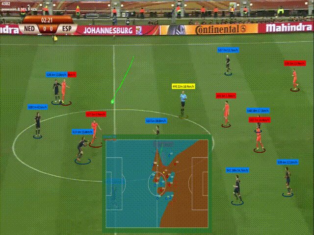

# Football Computer Vision

The pipeline turns a match video into player tracks and an annotated overview. It detects people and the ball, maps the camera view to the pitch, assigns teams, and can add a minimap and match statistics.

Three Kaggle notebooks cover object detection, pitch-line estimation and player re-identification.

# Preview


## Repository layout

```text
checkpoints/
  calibration/       HRNet pitch-line checkpoint
  detection/         YOLO football-object checkpoint
  reid/              OSNet player re-identification checkpoint
datasets/
  matches/           Full match videos
  prepared/          Converted datasets ready for training
  raw/               Downloaded or original datasets
  samples/           Short clips for testing the pipeline
demo/                Example output
notebooks/            Kaggle notebooks for the three model trainings
pipeline/             Video-processing stages and their shared output-path helper
runs/                 Generated CSV files, videos and other run outputs
scripts/
  datasets/           Downloading, preparing, converting and inspecting datasets
  inference/          Standalone YOLO inference helper
requirements.txt      Python dependencies
```

Datasets, videos, weights and run outputs can take up considerable space. The `.gitignore` file excludes local credentials and most generated data.

## Architecture

The analysis combines image-space detections with estimates in pitch coordinates. YOLO finds players, goalkeepers, referees and ball candidates in each frame. HRNet predicts field markings; their fitted lines and intersections provide landmarks for estimating a homography from the image to the 105×68 metre pitch. The homography is estimated per frame and can be propagated or refined as the camera moves.

Person detections are linked across frames using box overlap and a Kalman filter, with camera-motion compensation to reduce the effect of panning. Track association can also use shirt and shorts color histograms or the separately trained OSNet appearance model. Pitch positions provide another association cue when calibration is available. Tracks with weak confidence, too few detections or little movement can be discarded; uncertain team assignments and appearance matches are left unresolved rather than treated as certain.

Team assignment clusters player-track color features, while ball tracking selects a plausible path from multiple detections. The ball path is checked against people boxes, static regions and movement limits, and can be evaluated in pitch coordinates when a homography is available. The renderer joins these results by frame and track ID, projects player foot points onto the pitch, and can calculate distance, speed, possession and Voronoi territory.

The stages exchange CSV files, so they can be run separately and inspected between steps. Calibration is useful for pitch-based tracking, ball filtering and minimap statistics, but tracking can fall back to image-space association when no valid homography is available.

## Running the pipeline

Run the full sequence from the repository root:

```powershell
python pipeline\run.py 
  --sample datasets\samples\sample_football.mp4 
  --model checkpoints\detection\bestDetection.pt 
  --weights checkpoints\calibration\bestKeypoints.pt 
  --out sample_football 
  --voronoi --stats --ball-trail
```

Results go to `runs\sample_football`. A relative value such as `--out out` is resolved under `runs`; an absolute output path is left unchanged. Use `--stages` to run selected stages, `--skip-existing` to reuse existing outputs, or `--render-stages` to save intermediate videos. Options for individual stages can be passed with flags such as `--detect-args` and `--track-args`.

Each stage can also be run on its own. Its `--help` output lists the available options:

```powershell
python pipeline\detect.py --help
python pipeline\homography.py --help
python pipeline\track.py --help
python pipeline\teams.py --help
python pipeline\ball.py --help
python pipeline\render.py --help
```

## Training

The training notebooks run is done in Kaggle, the training scripts are included in `notebooks\` though. 

### Football object detection

The [YOLO training notebook](./notebooks/yolo11l_detection_training_kaggle.ipynb) fine-tunes Ultralytics YOLO11 large from `yolo11l.pt`.

It uses the Kaggle dataset `manuelht311/roboflow-football-detection`, which is already in YOLO format. The notebook trains for up to 50 epochs at image size 1280 with batch size 6 and early stopping patience 20. The dataset class names must match the labels expected by the pipeline: `player`, `goalkeeper`, `referee` and `ball`.

Pass the resulting checkpoint to the detection stage:

```powershell
python pipeline\detect.py
  --model checkpoints\detection\bestDetection.pt 
  --sample datasets\samples\sample_football.mp4 
  --out detection-test 
  --render
```

The script writes `detections.csv`, with a row for each predicted box, its frame, label, coordinates and confidence. `--render` also saves `sample_detections.mp4`.

### Pitch-line and homography model

The [HRNet notebook](./notebooks/hrnet_line_maps_training_kaggle.ipynb) trains HRNet-W32 to predict heatmaps for 28 pitch markings. It starts from compatible pretrained HRNet weights when available.

The data comes from SoccerNet Calibration 2023. Convert its annotations with `scripts/datasets/convert/calibration_to_hrnet_lines.py`; the prepared dataset has `train`, `val` and `test` splits plus a `metadata.json` file listing the classes.

Training uses 960×540 images, output maps at stride 4, batch size 4 and six epochs. The loss combines weighted binary cross-entropy and Dice loss. The notebook saves `best.pt` according to validation macro Dice and `last.pt` for resuming. Copy the selected checkpoint to `checkpoints\calibration\bestKeypoints.pt` or pass its location with `--weights`.

During inference, the pipeline fits lines to the predicted maps, finds their intersections and uses those landmarks to estimate a homography for each frame. It also propagates and refines estimates between detections, with scene-cut handling.

### Player re-identification

The [OSNet notebook](./notebooks/osnet_triplet_finetune_kaggle.ipynb) fine-tunes OSNet x1.0 from ImageNet-pretrained weights with batch-hard triplet loss.

Prepare its player and goalkeeper crops from SoccerNet Tracking 2023 with `scripts/datasets/prepare_soccernet_reid.py`. The script keeps the official test games separate and holds out training game 9 for validation by default. It joins identities across clips only when match metadata includes a jersey number and team side; otherwise, each tracklet remains local to its sequence.

Training uses batches of 16 identities with four 256×128 images per identity and a triplet margin of 0.3. The notebook saves `best.pt` based on validation mAP and `last.pt` for resuming. To use the best checkpoint in the tracker:

```powershell
python pipeline\track.py 
  --detections runs\sample_football\detections.csv 
  --sample datasets\samples\sample_football.mp4 
  --reid osnet 
  --reid-weights checkpoints\reid\bestReID.pt 
  --out sample_football
```

The notebook clones `deep-person-reid` for `torchreid`. The project is also listed in `requirements.txt` for local OSNet tracking. If you do not have it installed, use the tracker's HSV histogram features with `--reid hist` or turn appearance matching off with `--reid none`.

## Downloading the checkpoints

The latest checkpoints are published on my [Kaggle profile](https://www.kaggle.com/manuelht311). Open the Models section, choose the model you need, and download its current version. If a checkpoint is only available as a notebook output, download it from that notebook's Output panel instead.

Place the downloaded files in these locations, or pass their actual paths to the pipeline:

| Model | Local path used in the examples |
| --- | --- |
| YOLO football detector | `checkpoints\detection\bestDetection.pt` |
| HRNet pitch-line model | `checkpoints\calibration\bestKeypoints.pt` |
| OSNet re-identification model | `checkpoints\reid\bestReID.pt` |

## Pipeline stages

Run these commands from the repository root. Relative `--out` values go under `runs`.

### 1. Detection

```powershell
python pipeline\detect.py 
  --model checkpoints\detection\bestDetection.pt 
  --sample datasets\samples\sample_football.mp4 
  --frames 120 --start-frame 0 
  --out sample_football 
  --render
```

YOLO processes the selected frames and writes predictions above `--conf` to `detections.csv`. The CSV contains `frame`, `label`, `x1`, `y1`, `x2`, `y2` and `conf`. `--draw-conf` sets the display threshold for `sample_detections.mp4`; it does not change which rows go into the CSV. Use `--imgsz` to set the inference size.

### 2. Pitch calibration

```powershell
python pipeline\homography.py 
  --sample datasets\samples\sample_football.mp4 
  --weights checkpoints\calibration\bestKeypoints.pt 
  --tracks runs\sample_football\detections.csv 
  --stride 5 --out sample_football 
  --render
```

For each selected frame, HRNet predicts pitch-line maps. The script fits lines and finds their intersections, then estimates the mapping from image coordinates to a 105×68 metre pitch. RANSAC, inlier counts, reprojection error and pitch bounds are used to check the estimate. Between detections, camera motion propagates the last estimate and visible lines can refine it. The optional `--tracks` file provides people boxes to mask during camera-motion estimation. `--stride` controls landmark detection frequency when calibration is working; `--retry` sets how often to retry after a failure.

`homography.csv` contains a row per frame and nine homography values. `keypoints.csv` records the detected landmarks and whether each was an inlier. `--render` saves `pitch.mp4`; `--debug-frame N` saves a diagnostic overlay for one frame.

### 3. Player tracking

```powershell
python pipeline\track.py 
  --detections runs\sample_football\detections.csv 
  --sample datasets\samples\sample_football.mp4 
  --homography runs\sample_football\homography.csv 
  --out sample_football 
  --render
```

The tracker keeps the requested labels and links boxes over time with a Kalman filter and Hungarian assignment, using box overlap to score matches. Camera-motion compensation is on by default. A homography lets the tracker compare player foot positions in metres. By default, `--reid hist` uses shirt and shorts color features. `--reid osnet --reid-weights PATH` selects the trained OSNet model; `--reid none` disables appearance matching. Confidence, track length and movement thresholds filter the results.

`tracks.csv` contains the retained tracks and their `track_id` values. `tracks_dropped.csv` contains tracks removed by the final filters. `--render` saves `tracks.mp4`. Without a valid homography, matching uses image-space information.

### 4. Team assignment

```powershell
python pipeline\teams.py 
  --tracks runs\sample_football\tracks.csv 
  --sample datasets\samples\sample_football.mp4 
  --k 2 --out sample_football 
  --render
```

The script samples clear crops from each eligible player track and extracts HSV histograms from the torso, filtering out grass-colored pixels. PCA reduces the feature size before weighted K-means assigns tracks to `--k` groups. Tracks with ambiguous assignments or outlier distances remain unassigned.

`teams.csv` maps track IDs to team assignments and includes confidence and crop counts. `tracks_teams.csv` adds those assignments to the track rows. `--render` saves `teams.mp4`.

### 5. Ball tracking

```powershell
python pipeline\ball.py 
  --detections runs\sample_football\detections.csv 
  --sample datasets\samples\sample_football.mp4 
  --homography runs\sample_football\homography.csv 
  --out sample_football 
  --render
```

The detector can return several ball candidates per frame. This stage scores paths across frames, then filters candidates outside the pitch, inside the upper part of people boxes, in persistent static clusters or moving at implausible speeds. With homographies, it checks movement in pitch coordinates and interpolates short gaps there to account for camera motion.

`ball.csv` has one row per frame with the selected image coordinates, confidence and an `interpolated` flag. `--render` saves `ball_track.mp4` with the selected path and rejected candidates.

### 6. Rendering and statistics

```powershell
python pipeline\render.py 
  --sample datasets\samples\sample_football.mp4 
  --tracks runs\sample_football\tracks.csv 
  --teams runs\sample_football\teams.csv 
  --homography runs\sample_football\homography.csv 
  --ball runs\sample_football\ball.csv 
  --out sample_football 
  --voronoi --stats --ball-trail
```

The renderer projects each player's foot point onto the pitch and overlays a minimap. It can color players by team and show the ball, its trail and the nearest player to it. `--voronoi` colors each pitch area by its closest player and can retain positions for unseen players for up to `--memory-s` seconds. `--stats` adds smoothed speed and total distance to the video and writes `stats.csv`. `--ball-trail` draws the ball path on the video and minimap.

The sample video, tracks and homography CSV are required. Team and ball CSVs are optional. The script writes `overview.mp4`. Use `--start-frame` and `--frames` to limit the output to part of the clip.

## Dataset and utility scripts

Downloading SoccerNet data requires an account and password. `scripts/datasets/download_dataset.py` reads the password from `SOCCERNET_PASSWORD` in `.env`. Copy `.env.example` to `.env` and add your credential:

```text
SOCCERNET_PASSWORD=your_soccernet_password
```

The value in `.env.example` is a placeholder. The downloader saves Tracking 2023 data to `/datasets/soccernet`; change the path in `scripts/datasets/download_dataset.py` to use another location.

```powershell
python scripts\datasets\download_dataset.py
```

Other dataset and inference scripts:

| Script | What it does |
| --- | --- |
| `scripts/datasets/prepare_soccernet_reid.py` | Builds identity-folder crops, manifests and split summaries for the OSNet notebook. Defaults to `datasets\raw\soccernet-tracking-2023` and `datasets\prepared\soccernet-reid`. |
| `scripts/datasets/convert/calibration_to_hrnet_lines.py` | Converts SoccerNet calibration annotations into 28-channel HRNet line maps. Supports `--src`, `--dst`, `--limit` and `--resume`. |
| `scripts/datasets/visualize_hrnet_line_maps.py` | Saves sample overlays to check that prepared line maps align with their source images. |
| `scripts/datasets/prepare/build_subsample_list.py` | Creates frame-strided image lists and a dataset YAML for YOLO training. |
| `scripts/datasets/prepare/mix_datasets.py` | Copies selected image/label pairs from prebuilt dataset lists into a combined dataset. Its source and destination paths are set in the script. |
| `scripts/datasets/convert/coco_to_yolo.py` | Converts a selected COCO split to YOLO labels and writes `data.yaml`. |
| `scripts/datasets/convert/remap_fieldvision.py` | Remaps the configured FieldVision labels; review its input paths and class mapping before use. |
| `scripts/datasets/convert/calibration_to_pose.py` | Converts calibration line annotations to a keypoint-style YOLO dataset; this is a separate format from the 28-channel HRNet line-map dataset. |
| `scripts/datasets/inspect_json.py` | Small helper for inspecting annotation JSON files. |
| `scripts/inference/detect.py` | Runs Ultralytics prediction and saves its standard prediction results, with optional text labels. |

Run a command-line script with `--help` to see its options. The mix and remap scripts use paths defined in the source, so edit those before using another dataset.

## Libraries

Install the dependencies from the repository root:

```powershell
python -m pip install -r requirements.txt
```

For NVIDIA GPUs, install PyTorch and torchvision builds that match your CUDA setup. The HRNet and OSNet notebooks are intended for Kaggle GPU sessions. The OSNet notebook clones `deep-person-reid` for `torchreid`; local OSNet inference needs that package installed too.

| Library | Used for |
| --- | --- |
| Ultralytics | YOLO training and object detection inference. |
| PyTorch and torchvision | Model training and inference for YOLO, HRNet and OSNet. |
| OpenCV | Video and image processing, geometry and drawing. |
| NumPy and pandas | Array operations and pipeline CSV files. |
| SciPy | Track assignment and calibration refinement. |
| scikit-learn | PCA and team clustering. |
| SoccerNet | Dataset downloads. |
| python-dotenv | Reading the SoccerNet password from `.env`. |
| Pillow | Image loading for OSNet training. |
| PyYAML | YOLO dataset configuration. |
| psutil and yacs | Kaggle resource checks and HRNet configuration. |
| deep-person-reid (`torchreid`) | OSNet model and feature extraction. |

## Current limitations

The homography is only estimated when enough pitch landmarks are detected. That's the right call in closeups and replays, but it sometimes fails on perfectly usable wide shots too, and when it does, everything downstream in pitch coordinates disappears with it. The minimaps Voronoi view has a similar problem. It's built only from the players the camera happens to show, so when only a handful are visible the regions turn large and arbitrary and say very little about real space control.

Tracking is another weak point. Identities are often lost and recreated after camera cuts or big zoom changes, so the number of IDs ends up far higher than the number of people on the pitch. This means per player stats like distance covered are really computed over short, broken tracks. Detection is a bit inconsistent as well, some medium shots with several clearly visible players come out with no annotations at all, and players near the edges of the frame sometimes never get a team assigned.

Speed and distance are affected by every error from the homography, making unrealistic info. Possession behaves oddly at the start of a sequence, when it's calculated from only a few samples.

## Future work

- Derive more match information from the Voronoi diagrams and team territories
- Keep improving the detection, pitch-line and re-identification models :)
- Build a visual match analysis interface where users can enter shirt numbers before processing, giving the analysis more useful player context
- Separate pipeline logic from its command-line scripts and move experiment settings into configuration files to make runs easier to reproduce and compare
- Adapt the pipeline to process frames continuously and analyse a live match
- Port performance-critical parts of the architecture to a faster language such as C++

## Use of AI

I used AI assistants throughout this project to refactor much of the code, including the training notebooks and several pipeline stages, and to suggest fixes and syntax. I chose the datasets and models, trained the detector, pitch-line and re-identification models myself, reviewed the outputs of each stage, and tuned the parameters by hand.

## Credits

[SoccerNet](https://www.soccer-net.org/) for the datasets used in this project, and [FIFA's YouTube channel](https://www.youtube.com/@FIFA) for match footage used to test the pipeline.

Homography estimation was the most demanding part of this project. The approach was inspired by [soccernet-calibration-sportlight](https://github.com/NikolasEnt/soccernet-calibration-sportlight/tree/master) and the work it builds on, changing heatmap representation for direct line segmentation. This implementation uses a different dataset, keypoint setup and training process.

The repository cites the following paper:

```bibtex
@inproceedings{falaleev2024enhancing,
  author = {Falaleev, Nikolay S. and Chen, Ruilong},
  title = {Enhancing Soccer Camera Calibration Through Keypoint Exploitation},
  year = {2024},
  isbn = {9798400711985},
  publisher = {Association for Computing Machinery},
  address = {New York, NY, USA},
  doi = {10.1145/3689061.3689074},
  booktitle = {Proceedings of the 7th ACM International Workshop on Multimedia Content Analysis in Sports},
  pages = {65--73},
  series = {MMSports '24}
}
```
